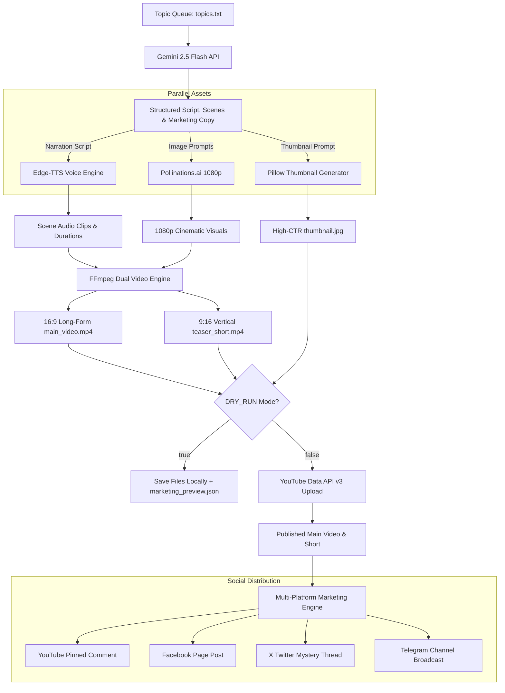

# 🎬 Automated Documentary YouTube Creator, Uploader & Multi-Platform Marketing Agent

[](#-100-free-architecture)
[](https://www.python.org/)
[](LICENSE)

An enterprise-grade, completely automated, end-to-end documentary video production and social marketing engine. From a single mystery or history topic (or reading automatically from a `topics.txt` queue), it autonomously researches and writes an investigative documentary script (in **Urdu**, **Hindi**, or **English**), synthesizes natural human-like voiceovers, fetches 1080p cinematic AI visuals, edits a **16:9 long-form video** and a **9:16 vertical teaser Short**, composites high-CTR YouTube thumbnails, uploads to YouTube, and automatically markets the video across **Facebook**, **X (Twitter)**, and **Telegram**—using **zero paid APIs**.

---

## 🌟 Key Features

- **Zero Paid APIs / 100% Free Pipeline**:
  - 🧠 **Script & Marketing Copy**: Google Gemini Free API (`gemini-3.8-flash`) via Google AI Studio.
  - 🎙️ **Human-like Voiceover**: Microsoft `edge-tts` (supports natural Urdu `ur-PK-AsadNeural`, Hindi `hi-IN-MadhurNeural`, and English).
  - 🎨 **Visual Asset Generation**: Pollinations.ai 1080p photorealistic illustrations (no API key required).
  - 🎞️ **Dual Video Renderer (FFmpeg)**:
    - **16:9 Long-Form Video (`main_video.mp4`)**: Dynamic Ken Burns (`zoompan`) motion + lower-third subtitle overlay + 12% ambient audio looping.
    - **9:16 Vertical Teaser Short (`teaser_short.mp4`)**: Converts high-intensity hook scenes into a vertical Short/Reel with blurred background and top/bottom CTA banner (*"WATCH FULL DOCUMENTARY ON CHANNEL 👇"*).
  - 🖼️ **Automated Thumbnail Compositor**: Pillow-based typography, multi-pass drop shadow, thick black contrast stroke, and dark vignette.
  - 🚀 **YouTube Auto-Uploader**: Official YouTube Data API v3 with resumable chunked uploading, category selection, privacy control, custom thumbnail attachment, and optional YouTube Shorts publishing.
  - 📢 **Auto-Marketing & Social Distribution (`src/marketing.py`)**:
    - **YouTube Pinned Comment**: Automatically posts a curiosity question to trigger discussion.
    - **Facebook Page Post**: Posts thumbnail + storytelling caption + YouTube link via Facebook Graph API.
    - **X (Twitter) Thread**: Automatically publishes a 3–4 tweet cliffhanger thread linking to the video.
    - **Telegram Channel Broadcast**: Sends photo with formatted markdown summary caption via Telegram Bot API.
  - 📋 **Topic Queue Management**: Reads `topics.txt` and automatically logs completed runs in `completed_topics.txt` so topics never repeat.
  - 🛡️ **Safe Dry Run Mode**: Generates all videos, thumbnails, and preview marketing copy (`marketing_preview.json`) locally without touching live APIs.
  - 🤖 **GitHub Actions Automation**: Fully scheduled daily execution via `.github/workflows/pipeline.yml`.

---

## 📐 Architecture & Pipeline Flow



---

## 📂 Repository Structure

```
youtube-ai-agent/
├── .github/
│   └── workflows/
│       └── pipeline.yml        # GitHub Actions automated workflow
├── assets/
│   ├── fonts/
│   │   └── font.ttf            # Bundled bold font for overlays & thumbnails
│   └── bg_music.wav            # Cinematic ambient drone audio loop
├── src/
│   ├── __init__.py
│   ├── config.py               # Environment configuration and auto-discovery
│   ├── topic_manager.py        # Topic queue management & completion tracking
│   ├── script_generator.py     # Gemini AI documentary script & marketing copy parser
│   ├── voice_generator.py      # Edge-TTS voiceover synthesis & duration measurement
│   ├── image_generator.py      # Pollinations.ai asset downloader with retry logic
│   ├── thumbnail_generator.py  # Pillow vignette & high-CTR typography compositor
│   ├── video_editor.py         # FFmpeg dual renderer (16:9 long video + 9:16 teaser Short)
│   ├── uploader.py             # YouTube Data API v3 uploader (Main + Shorts)
│   └── marketing.py            # Multi-platform distribution (YouTube, FB, X, Telegram)
├── topics.txt                  # Unused topic queue
├── completed_topics.txt        # History of completed topics
├── .env.example                # Example environment configuration
├── .gitignore
├── requirements.txt            # Python dependencies
├── get_youtube_token.py        # Interactive OAuth2 Refresh Token assistant
├── main.py                     # Pipeline CLI orchestrator
├── PROGRESS.md                 # Complete handover & continuation document
└── README.md                   # Complete documentation
```

---

## 🛠️ Prerequisites

1. **Python 3.9+**
2. **FFmpeg & FFprobe**:
   - **macOS**: `brew install ffmpeg`
   - **Ubuntu/Debian**: `sudo apt update && sudo apt install -y ffmpeg`
   - **Windows**: Download from [gyan.dev](https://www.gyan.dev/ffmpeg/builds/) or run `winget install Gyan.FFmpeg`

---

## ⚡ Quick Start (Local Setup)

> [!TIP]
> **Using an AI Agent on another computer?** Simply clone this repository and give your AI agent this prompt:
> 
> ```text
> README.md aur PROGRESS.md read karo, FFmpeg verify/install karo, aur mera environment setup kar ke complete playable dry-run video generate karo.
> ```

### 1. Clone & Set Up Virtual Environment

```bash
git clone https://github.com/AhsanAli-Soomro/my-youtube-agent.git
cd my-youtube-agent

# Create and activate virtual environment
python3 -m venv .venv
source .venv/bin/activate  # On Windows: .venv\Scripts\activate

# Install dependencies
pip install -r requirements.txt
```

### 2. Configure Environment Variables

Copy `.env.example` to `.env`:

```bash
cp .env.example .env
```

Fill in your free Gemini API key:

```env
# Google Gemini Free API Key (Required)
# Get yours at: https://aistudio.google.com/
GEMINI_API_KEY=your_gemini_api_key_here

LANGUAGE=urdu                 # Choices: urdu, hindi, english
VOICE_NAME=ur-PK-AsadNeural   # Deep suspenseful male voice
DRY_RUN=true                  # Safe local testing mode
```

---

## 🚀 Running the Pipeline

### 1. Dry Run Test (Recommended First)
Generates the 16:9 main video, 9:16 vertical teaser Short, thumbnail, and marketing copy preview without uploading:

```bash
python main.py --dry-run
```
*(By default, it automatically picks the first unused topic from `topics.txt`)*

Or specify an exact topic:
```bash
python main.py --topic "The Mysterious Disappearance of Flight 370" --duration 2 --lang urdu --dry-run
```

### 2. Live Run (Publish & Market Everywhere)
```bash
python main.py --live
```
This will:
1. Upload `main_video.mp4` to YouTube.
2. Upload `teaser_short.mp4` as a YouTube Short.
3. Post the pinned discussion comment on YouTube.
4. Publish the thumbnail & caption to your Facebook Page.
5. Post the connected suspense thread to X (Twitter).
6. Broadcast the announcement to your Telegram Channel.
7. Record the topic in `completed_topics.txt`.

---

## 🔑 Marketing API Configuration (All Free / Optional)

Each social platform is toggleable. If any credentials are left blank in `.env`, that platform is safely skipped without errors.

### 1. YouTube Data API v3 (Uploads & Pinned Comments)
Run the built-in helper script to generate your OAuth2 Refresh Token:
```bash
python get_youtube_token.py
```

### 2. Facebook Page Auto-Post (Facebook Graph API)
1. Go to [Meta for Developers](https://developers.facebook.com/).
2. Create an App > Select **Business** > Add **Pages API**.
3. Generate a Never-Expiring Page Access Token via Graph API Explorer.
4. Add to `.env`:
   ```env
   FACEBOOK_PAGE_ID=your_page_id
   FACEBOOK_PAGE_ACCESS_TOKEN=your_page_access_token
   ```

### 3. X (Twitter) API v2 (Thread Poster)
1. Go to [X Developer Portal](https://developer.x.com/).
2. Create a Free Project / App.
3. Enable **OAuth 1.0a** with **Read and Write** permissions.
4. Generate Consumer Keys & Access Tokens and add to `.env`:
   ```env
   TWITTER_API_KEY=...
   TWITTER_API_SECRET=...
   TWITTER_ACCESS_TOKEN=...
   TWITTER_ACCESS_SECRET=...
   ```

### 4. Telegram Channel Broadcast (Telegram Bot API - 100% Free)
1. Open Telegram and search for `@BotFather` > Send `/newbot` to get your `TELEGRAM_BOT_TOKEN`.
2. Create a public or private Telegram Channel.
3. Add your bot as an **Administrator** in the channel.
4. Add to `.env`:
   ```env
   TELEGRAM_BOT_TOKEN=123456789:ABCdefGhIJKlmNoPQRstuVWXyz
   TELEGRAM_CHAT_ID=@your_channel_username  # (or -100xxxxxxxxxx for private)
   ```

---

## 🎙️ Recommended Voices

| Language | Voice Name | Rate | Pitch | Style |
| :--- | :--- | :--- | :--- | :--- |
| **Urdu** | `ur-PK-AsadNeural` | `-5%` | `-2Hz` | Deep investigative mystery (Info with Ahsan) |
| **Urdu** | `ur-PK-UzmaNeural` | `-3%` | `-1Hz` | Clear investigative female |
| **Hindi** | `hi-IN-MadhurNeural` | `-5%` | `-2Hz` | Compelling documentary male |
| **Hindi** | `hi-IN-SwaraNeural` | `-4%` | `-1Hz` | Expressive narrative female |
| **English** | `en-US-ChristopherNeural`| `-4%` | `-2Hz` | Authoritative Vox / MagnatesMedia |

---

## 📜 License

MIT License. Free for personal, commercial, and educational use.
