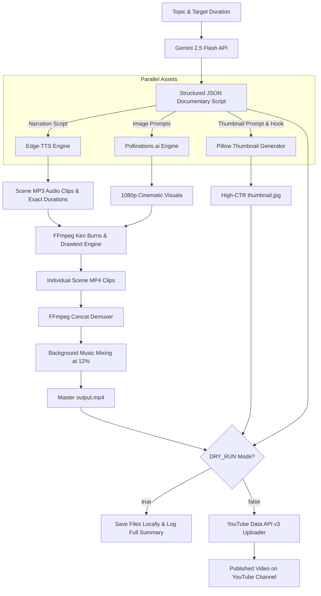

# 🎬 Automated Documentary YouTube Video Generator & Uploader

[](#-100-free-architecture)
[](https://www.python.org/)
[](LICENSE)

An enterprise-grade, completely automated, end-to-end documentary video production engine. From a single mystery or history topic prompt, it autonomously generates an ultra-high-retention investigative documentary script (in **Urdu**, **Hindi**, or **English**), synthesizes natural human-like voiceovers, fetches 1080p cinematic AI visuals, edits smooth Ken Burns motion videos with lower-third titles, composites high-CTR YouTube thumbnails, and uploads the video directly to YouTube via OAuth2.

---

## 🌟 Key Features

- **Zero Paid APIs / 100% Free Pipeline**:
  - 🧠 **Script & Prompt Engineering**: Google Gemini Free API (`gemini-2.5-flash`) via Google AI Studio.
  - 🎙️ **Human-like Voiceover**: Microsoft `edge-tts` (supports natural Urdu `ur-PK-AsadNeural`, Hindi `hi-IN-MadhurNeural`, and English).
  - 🎨 **Visual Asset Generation**: Pollinations.ai 1080p photorealistic illustrations (no API key required).
  - 🎞️ **Cinematic Video Editing**: FFmpeg dynamic Ken Burns effect (alternating slow zoom-in/zoom-out) + fade-in lower-third text overlay + 12% ambient audio looping.
  - 🖼️ **Automated Thumbnail Compositor**: Pillow-based high-CTR typography, multi-pass drop shadow, thick contrast stroke, and dark vignette.
  - 🚀 **YouTube Auto-Uploader**: Official YouTube Data API v3 with resumable chunked uploading, category selection, privacy control, and auto-attached custom thumbnails.
- **Documentary Pacing (Vox / MagnatesMedia / Info with Ahsan style)**:
  - 5-second curiosity hook in Scene 1.
  - Escalating suspense, historical archive atmosphere, and twist resolutions.
- **Safe Dry Run Mode**: Test full script, voice, visual, and video generation locally without touching the YouTube API.
- **GitHub Actions Ready**: Run automatically on a recurring schedule or trigger manually with custom topics via GitHub Actions.

---

## 📐 Architecture & Pipeline Flow



---

## 📂 Repository Structure

```
youtube-ai-agent/
├── .github/
│   └── workflows/
│       └── auto_publish.yml    # GitHub Actions automated workflow
├── assets/
│   ├── fonts/
│   │   └── font.ttf            # Bundled bold font for overlays & thumbnails
│   └── bg_music.wav            # Cinematic ambient drone audio loop
├── src/
│   ├── __init__.py
│   ├── config.py               # Environment configuration and auto-discovery
│   ├── script_generator.py     # Gemini AI documentary script & scene parser
│   ├── voice_generator.py      # Edge-TTS voiceover synthesis & duration measurement
│   ├── image_generator.py      # Pollinations.ai asset downloader with retry logic
│   ├── thumbnail_generator.py  # Pillow vignette & high-CTR typography compositor
│   ├── video_editor.py         # FFmpeg Ken Burns, subtitles, concat & audio mix
│   └── uploader.py             # YouTube Data API v3 resumable uploader
├── .env.example                # Example environment configuration
├── .gitignore
├── requirements.txt            # Python dependencies
├── get_youtube_token.py        # Interactive OAuth2 Refresh Token assistant
├── main.py                     # Pipeline CLI orchestrator
└── README.md                   # Complete documentation
```

---

## 🛠️ Prerequisites

1. **Python 3.9+**
2. **FFmpeg & FFprobe**:
   - **macOS**: `brew install ffmpeg`
   - **Ubuntu/Debian**: `sudo apt update && sudo apt install -y ffmpeg`
   - **Windows**: Download from [gyan.dev](https://www.gyan.dev/ffmpeg/builds/) or run `winget install Gyan.FFmpeg`
   - Verify installation:
     ```bash
     ffmpeg -version
     ffprobe -version
     ```

---

## ⚡ Quick Start (Local Setup)

### 1. Clone & Set Up Virtual Environment

```bash
cd "youtube ai agent"

# Create and activate virtual environment
python3 -m venv .venv
source .venv/bin/activate  # On Windows: .venv\Scripts\activate

# Install dependencies
pip install -r requirements.txt
```

### 2. Configure Environment Variables

Copy `.env.example` to `.env`:

```bash
cp .env.example .env
```

Open `.env` and fill in your keys:

```env
# 1. Google Gemini Free API Key (Required)
# Get yours in 30 seconds at: https://aistudio.google.com/
GEMINI_API_KEY=AIzaSy...

# 2. Content & Language
LANGUAGE=urdu                 # Choices: urdu, hindi, english
TARGET_DURATION_MINUTES=2     # Duration in minutes

# 3. Voice Settings (Edge-TTS)
VOICE_NAME=ur-PK-AsadNeural   # Deep suspenseful male voice
VOICE_RATE=-5%                # Deliberate documentary pacing
VOICE_PITCH=-2Hz              # Deep resonant pitch

# 4. Dry Run Mode
DRY_RUN=true                  # Set to true for safe local testing
```

---

## 🔑 YouTube API & OAuth Setup (One-Time)

To enable automatic uploads to your YouTube channel:

1. Open [Google Cloud Console](https://console.cloud.google.com/).
2. Create a new project (e.g. `YouTube Video Automator`).
3. Navigate to **APIs & Services** > **Library**, search for **YouTube Data API v3**, and click **Enable**.
4. Go to **APIs & Services** > **OAuth consent screen**:
   - User Type: **External**.
   - App Name: `YouTube Uploader`.
   - Add your own email under **Test Users**.
5. Go to **APIs & Services** > **Credentials** > **Create Credentials** > **OAuth client ID**:
   - Application type: **Desktop app**.
   - Click **Create**.
6. Run the included helper script to generate your permanent `YOUTUBE_REFRESH_TOKEN`:
   ```bash
   python get_youtube_token.py
   ```
7. A browser window will open. Authorize your channel. The script will output your credentials and can automatically save them directly into your `.env` file!

---

## 🚀 Running the Pipeline

### 1. Test Run (Dry Run Mode)
Generates the complete documentary script, voiceover clips, visual assets, thumbnail, and renders `output.mp4` locally without uploading:

```bash
python main.py --topic "The Mysterious Disappearance of Flight 370" --duration 2 --lang urdu --dry-run
```

### 2. Live Run (Generate & Upload to YouTube)
Once you are happy with the quality, switch to live publishing:

```bash
python main.py --topic "The Secrets of the Bermuda Triangle" --duration 2 --lang urdu --live
```

### 3. Hindi or English Documentaries

```bash
# Hindi documentary (uses hi-IN-MadhurNeural voice & Devanagari script)
python main.py --topic "The Dyatlov Pass Incident" --duration 2 --lang hindi --dry-run

# English documentary (Vox / MagnatesMedia style)
python main.py --topic "The Rise and Fall of Lehman Brothers" --duration 3 --lang english --dry-run
```

---

## 🎙️ Voice Configuration Reference

Edge-TTS provides ultra-high quality neural voices for free. Recommended settings for mystery documentaries:

| Language | Voice Name | Recommended Rate | Recommended Pitch | Description |
| :--- | :--- | :--- | :--- | :--- |
| **Urdu** | `ur-PK-AsadNeural` | `-5%` | `-2Hz` | Deep, dramatic male narration (Info with Ahsan style) |
| **Urdu** | `ur-PK-UzmaNeural` | `-3%` | `-1Hz` | Clear, investigative female narration |
| **Hindi** | `hi-IN-MadhurNeural` | `-5%` | `-2Hz` | Authoritative, compelling documentary male |
| **Hindi** | `hi-IN-SwaraNeural` | `-4%` | `-1Hz` | Expressive narrative female |
| **English** | `en-US-ChristopherNeural`| `-4%` | `-2Hz` | Deep, cinematic investigative voice |
| **English** | `en-US-GuyNeural` | `-3%` | `+0Hz` | News & feature documentary voice |

---

## 🤖 GitHub Actions Automation

The repository includes a ready-to-run GitHub Actions workflow (`.github/workflows/auto_publish.yml`).

### Setup in GitHub:
1. Push this repository to GitHub.
2. Go to **Settings** > **Secrets and variables** > **Actions**.
3. Add the following **Repository Secrets**:
   - `GEMINI_API_KEY`
   - `YOUTUBE_CLIENT_ID`
   - `YOUTUBE_CLIENT_SECRET`
   - `YOUTUBE_REFRESH_TOKEN`
4. Add the following **Repository Variables** (optional):
   - `YOUTUBE_PRIVACY_STATUS` (`private` or `public`)
   - `VOICE_RATE` (`-5%`)
   - `VOICE_PITCH` (`-2Hz`)

### Manual Trigger:
Navigate to the **Actions** tab in GitHub > select **Automated YouTube Documentary Generator & Uploader** > click **Run workflow** > enter your topic and click **Run**.

### Scheduled Publishing:
The workflow is configured to run automatically every Monday & Thursday at 14:00 UTC. You can customize the cron in `.github/workflows/auto_publish.yml`.

All generated videos, thumbnails, and metadata are automatically retained as downloadable GitHub Actions artifacts for 14 days!

---

## 🛠️ Troubleshooting & FAQ

### 1. `ffmpeg: command not found`
Ensure FFmpeg is installed and on your system PATH (`brew install ffmpeg` on macOS, `apt install ffmpeg` on Linux). You can also set `FFMPEG_PATH=/path/to/ffmpeg` in `.env`.

### 2. Urdu/Hindi Text Font Issues
The pipeline uses `assets/fonts/font.ttf` for text rendering and falls back gracefully to system fonts (`Arial Bold` or `DejaVuSans-Bold`). You can replace `assets/fonts/font.ttf` with any TTF font of your choice (e.g. Jameel Noori Nastaleeq for Urdu calligraphy or Bebas Neue).

### 3. YouTube API Quota
YouTube Data API provides a free daily quota of 10,000 units. A video upload costs 1,600 units, allowing you to upload up to **6 automated videos every single day completely free**.

### 4. Background Music Customization
Replace `assets/bg_music.wav` or place an `assets/bg_music.mp3` file to customize the ambient music. The pipeline will automatically loop it at 12% volume underneath the voiceover.

---

## 📜 License

MIT License. Free for personal, commercial, and educational use.
